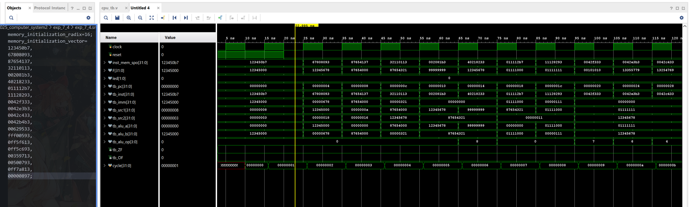
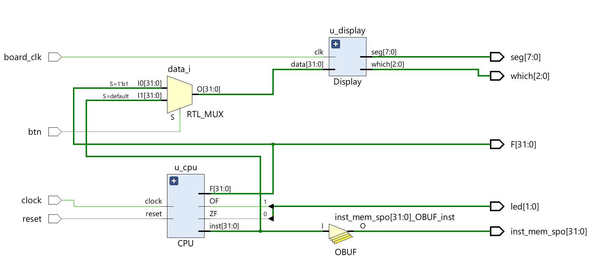
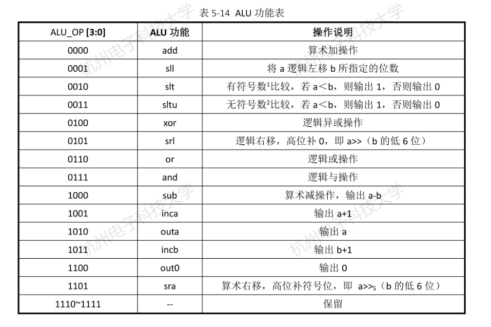

# 7.4：实现运算类指令的CPU设计实验

## **仿真结果**



## RTL电路图



## 运算类指令单周期CPU实验结果记录表

| Clock | 汇编指令 (Assembly) | 机器指令码 (Machine Code) | 执行结果 (F) | ZF   | OF   | 结论 (Conclusion) |
| ----- | ------------------- | ------------------------- | ------------ | ---- | ---- | ----------------- |
| 1     | lui x1, 0x12345     | 123450b7                  | 12345000     | 0    | 0    | 正确              |
| 2     | addi x1, x1, 0x678  | 67808093                  | 12345678     | 0    | 0    | 正确              |
| 3     | lui x2, 0x87654     | 87654137                  | 87654000     | 0    | 0    | 正确              |
| 4     | addi x2, x2, 0x321  | 32110113                  | 87654321     | 0    | 0    | 正确              |
| 5     | add x3, x1, x2      | 002081b3                  | 99999999     | 0    | 0    | 正确              |
| 6     | sub x4, x3, x2      | 40218233                  | 12345678     | 0    | 0    | 正确              |
| 7     | lui x5, 0x11111     | 011112b7                  | 1111000      | 0    | 0    | 正确              |
| 8     | addi x5, x5, 0x111  | 11128293                  | 1111111      | 0    | 0    | 正确              |
| 9     | and x6, x5, x4      | 0042f333                  | 101010       | 0    | 0    | 正确              |
| 10    | or x7, x5, x4       | 0042e3b3                  | 13355779     | 0    | 0    | 正确              |
| 11    | xor x8, x5, x4      | 0042c433                  | 13254769     | 0    | 0    | 正确              |
| 12    | sltu x9, x5, x4     | 0042b4b3                  | 1            | 0    | 0    | 正确              |
| 13    | sll x10, x5, x6     | 629533                    | 11110000     | 0    | 0    | 正确              |
| 14    | addi x11, x0, -1    | fff00593                  | ffffffff     | 0    | 0    | 正确              |
| 15    | andi x12, x11, 0xff | 0ff5f613                  | 000000ff     | 0    | 0    | 正确              |
| 16    | xori x13, x11, 0xff | 0ff5c693                  | ffffff00     | 0    | 0    | 正确              |
| 17    | slli x14, x11, 3    | 359713                    | fffffff8     | 0    | 0    | 正确              |
| 18    | addi x15, x0, 5     | 500793                    | 5            | 0    | 0    | 正确              |
| 19    | slti x16, x15, 0xff | 0ff7a813                  | 1            | 0    | 0    | 正确              |
| 20    | auipc x17, 0        | 897                       | 0000004c     | 0    | 0    | 正确              |

## 思考与探索

**Q**: 本实验未实现的其他运算类指令应该如何实现？其`ALU_OP`该怎样编码？

**A:**  本实验未实现`sra`，`srl`，实现指令需要为Decoder添加译码规则，为ALU添加额外的运算操作。`srl`所需的`ALU_OP`为`4'b0101`；`sra`所需的`ALU_OP`为`4'b1101`。`ALU`实现分别使用`>>` 和 `>>>`。编码方式采用第三位为`func3`，最高位为`func7[5]`的方式进行编码。

**Q**: 实验中使用的指令存储器为异步存储器，能否使用同步存储器完成单周期处理器的设计？为什么？

**A:** 不行，使用同步存储器需要两个时钟周期完成给地址和读数据的操作，单周期CPU需要在一个Cycle内完成每条指令的执行，在第二个周期开始时才读出指令数据不满足单周期CPU的设计要求。

**Q**: 说说你在实验中碰到了哪些问题，你是如何解决的？

**A:** 文档的目标运算指令集未要求实现`andi`和`xori`，但是文档提供的测试代码包括这二者，导致仿真结果有误，在Decoder中添加相应译码规则即可；sll的指令结构：`srl rd rs1 rs2[4:0]`, [参考](https://msyksphinz-self.github.io/riscv-isadoc/html/rvi.html#srl)[手册](https://msyksphinz-self.github.io/riscv-isadoc/html/rvi.html#sra)发现，运算器实验中ALU写成了rs2[5:0]（表5-14），虽然本实验（4.5）中没有实现srl；虽然本实验只要求实现了`stl`和`stli`，但是我们在Decoder中加上了`stl`；OF专注于补码有符号溢出：
$$
ZF = \overline{F_{31} + F_{30} + \dots + F_1 + F_0} \
OF = c_{31} \oplus c_s = a_{31} \oplus b_{31} \oplus F_{31} \oplus c_s
$$
$$a_{31} \oplus b_{31} \oplus F_{31}$$: 判断有无丢给31的进位$$c_s$$看有没有丢给32位的进位；如果二者不同（$$c_{32} = $$, $$c_{31} = 1$$正溢出 或者$$c_{32} = 1$$, $$c_{31} = 0$$负溢出）则是有符号溢出，无符号溢出发生在$$c_{32} = $$, $$c_{31} = $$ 只有正溢出。

我们实现是考虑：正加正得负，负加负得正的signed溢出：

```Verilog
assign OF = (ALU_OP == 4'b0000) ? (~(a[31] ^ b[31]) & (a[31] ^ F[31])) : // 正加正 -> 负
            (ALU_OP == 4'b1000) ? ((a[31] ^ b[31]) & (a[31] ^ F[31])) : // 负减正 -> 正
            1'b0;
```

